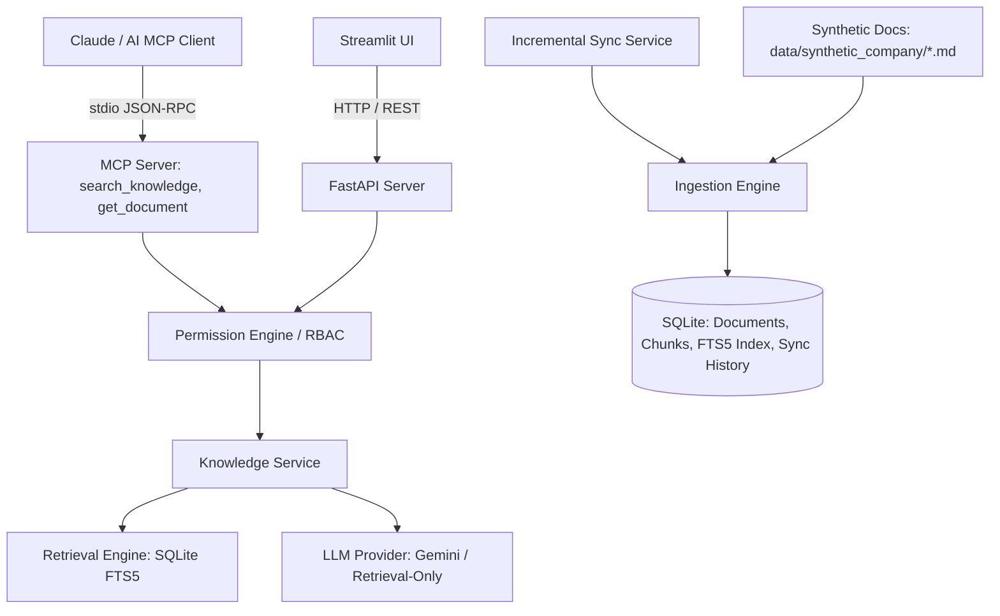

# Implementation Plan: Company Brain — AI Harness & Knowledge Platform

## 1. Overview
Company Brain is a secure, modular AI knowledge platform built for the fictional enterprise **Nexora Technologies**. It provides:
- Grounded document ingestion and incremental sync with SHA-256 fingerprinting.
- Keyword and full-text retrieval via SQLite FTS5 (with pluggable interface for future vector search).
- Multi-provider AI answering with Gemini API support, strict grounding, and graceful retrieval-only fallback.
- Server-enforced role-based access control (RBAC).
- Model Context Protocol (MCP) server over stdio for compatible AI agents.
- REST API with FastAPI and interactive Web UI with Streamlit.
- Comprehensive test suite and operational documentation.

## 2. Architecture & Components

## 3. Implementation Steps

1. **Synthetic Knowledge Base (`data/synthetic_company/`)**:
   - 15 realistic Markdown documents for Nexora Technologies with standard YAML frontmatter:
     - `id`: unique ID (e.g. `NEX-ENG-001`, `NEX-HR-002`, `NEX-SEC-001`, etc.)
     - `title`: human-readable title
     - `category`: e.g. Engineering, HR, Security, Product, Leadership
     - `author`: synthetic employee name
     - `last_updated`: ISO timestamp
     - `version`: semantic or numeric version
     - `access_classification`: `employee`, `manager`, `hr`, `finance`, `executive`, `admin`
     - Synthetic company disclaimer watermark on every document.

2. **Core Domain & Database (`app/models.py`, `app/database.py`, `app/config.py`)**:
   - Config loaded via `pydantic-settings` from `.env`.
   - SQLite tables:
     - `documents`: metadata, full content, hash, file path, version, access classification.
     - `document_chunks`: chunked content for fine-grained retrieval.
     - `documents_fts`: SQLite FTS5 virtual table indexing title, category, and chunk content.
     - `sync_log`: timestamp, status, files added, modified, deleted, errors.
   - Connection manager with concurrency locking for sync operations.

3. **Ingestion & Versioning (`app/ingestion.py`, `app/services/sync_service.py`)**:
   - Frontmatter parsing and validation via Pydantic models.
   - SHA-256 hash comparison to detect new, modified, unchanged, or deleted files.
   - Database transaction handling: update doc, re-chunk, update FTS index.
   - Thread-safe sync lock to avoid concurrent corruption.

4. **Security & Role-Based Access Control (`app/permissions.py`)**:
   - Roles: `employee`, `manager`, `hr`, `finance`, `executive`, `admin`.
   - Access hierarchy & role-to-classification matrix.
   - Server-side authorization filtering at the query level (unauthorized documents are filtered before retrieval results or full documents are returned).
   - Clear dev-mode identity header / token handling (`X-User-Role`, `X-User-Id`) with documented limitations.

5. **Modular Retrieval Engine (`app/retrieval.py`)**:
   - Abstract `BaseRetrievalEngine` interface.
   - `SQLiteFTS5RetrievalEngine` implementation with snippet generation, BM25 scoring, and role filtering.
   - Ready for drop-in vector/embedding search extension.

6. **AI Answer Generation (`app/llm/`)**:
   - `BaseLLMProvider` abstract class.
   - `RetrievalOnlyProvider` providing grounded, synthesized answers from excerpts without LLM when no API key is provided.
   - `GeminiProvider` using Google GenAI SDK with grounded prompt engineering, strict citation requirement, and explicit uncertainty admission when sources do not contain the answer.

7. **Knowledge Service & REST API (`app/services/knowledge_service.py`, `app/main.py`)**:
   - FastAPI endpoints:
     - `GET /health`
     - `GET /documents`
     - `GET /documents/{document_id}`
     - `POST /search`
     - `POST /ask`
     - `POST /sync`
     - `GET /sync/status`
   - Complete input validation and HTTP status codes (400, 401, 403, 404, 500).

8. **MCP Integration (`app/mcp_server.py`)**:
   - Official Python MCP SDK.
   - Expose tools: `search_knowledge` and `get_document`.
   - Input schema validation and server-enforced role authorization.
   - Transport: stdio.

9. **Streamlit User Interface (`ui/streamlit_app.py`)**:
   - Knowledge search & Q&A chat with citations.
   - Full document viewer with markdown rendering.
   - Role selector (switch roles to test access control).
   - Sync panel with status dashboard and trigger button.
   - Indicators for retrieval mode (LLM vs Retrieval-Only).

10. **Testing & Documentation (`tests/`, `README.md`, `.env.example`, `.gitignore`)**:
    - Comprehensive pytest suite covering:
      - Ingestion & hash detection (new, modified, deleted)
      - FTS5 retrieval & excerpt extraction
      - Role-based access control & unauthorized access rejection
      - Sync service concurrency locking
      - API endpoint integration
      - LLM fallback in retrieval-only mode
    - Detailed setup and run guide with PowerShell commands.
